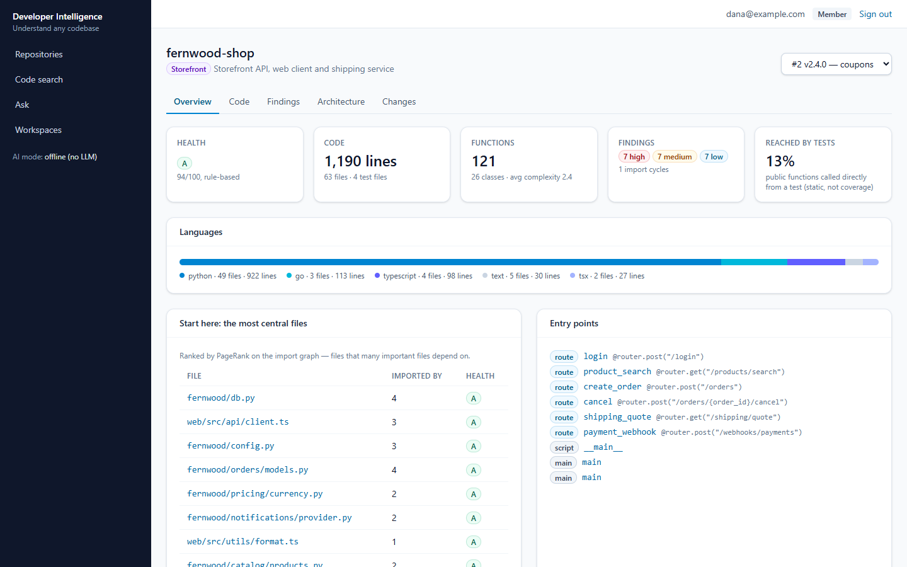
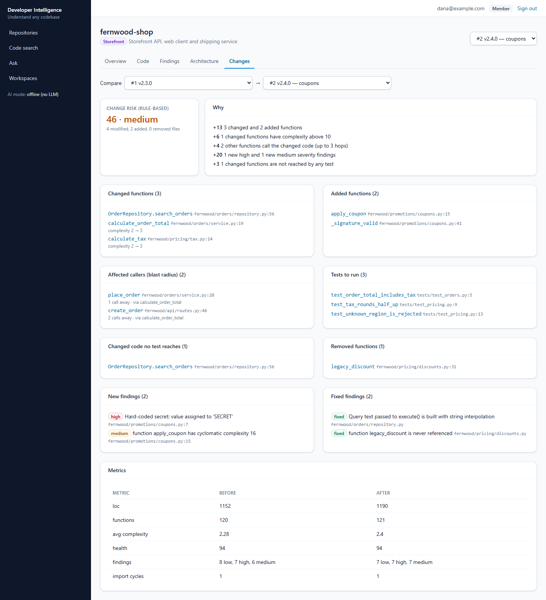
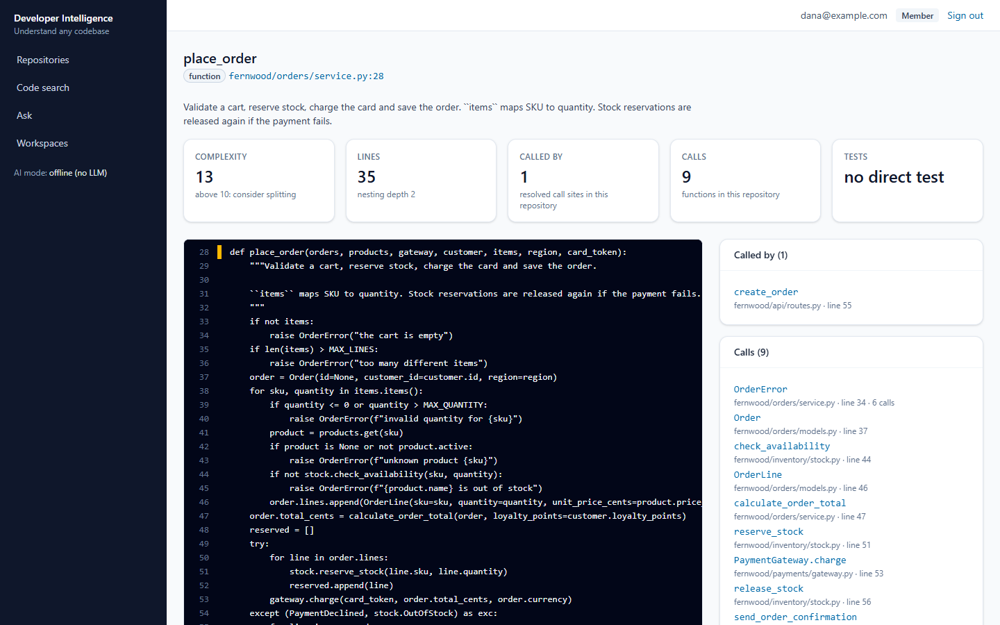
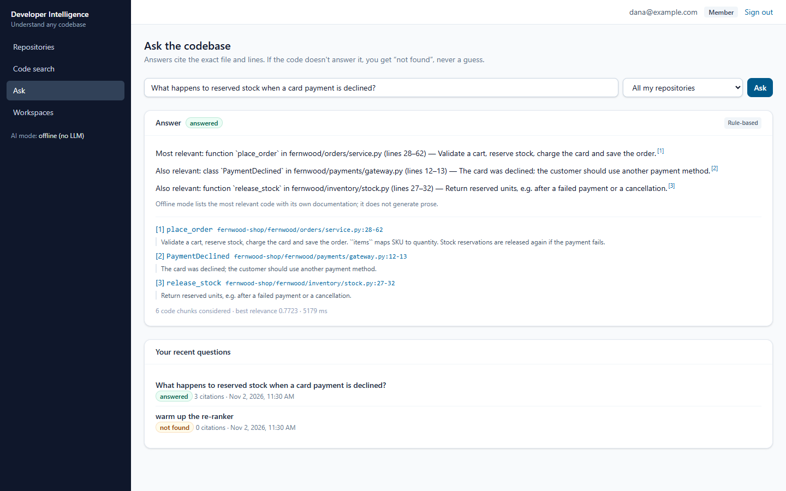
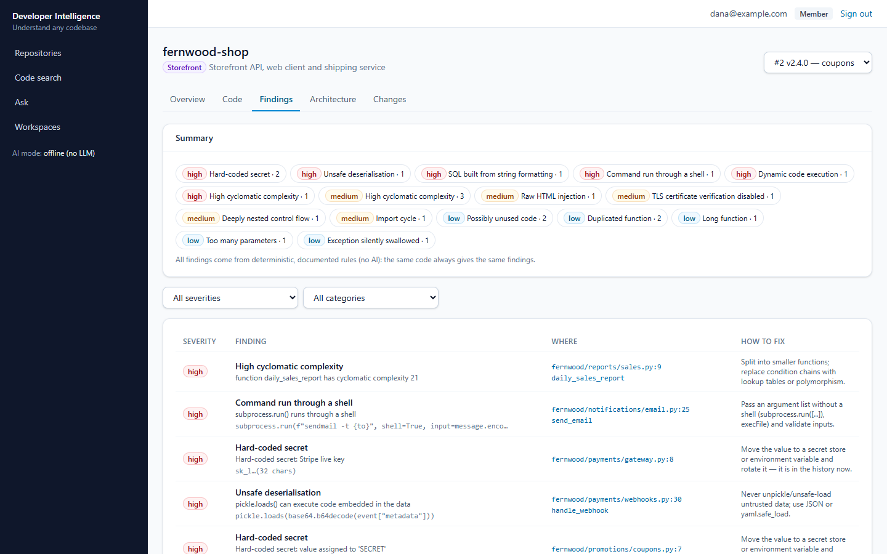
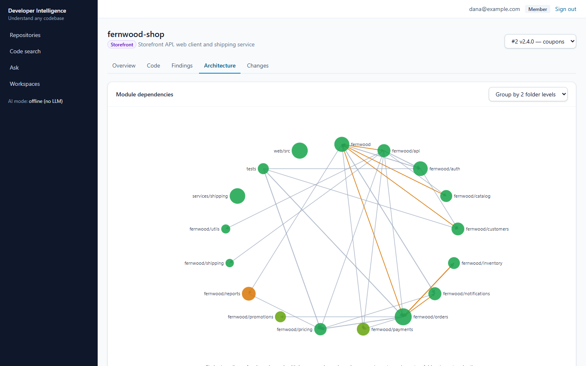
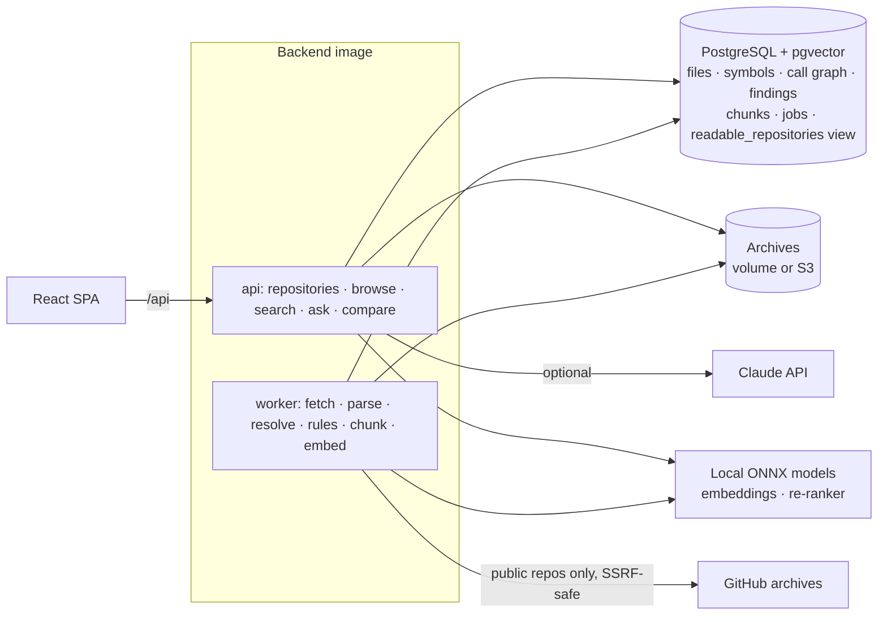

# AI Developer Intelligence

Understand any codebase quickly: import a repository (ZIP or public GitHub), then **search it by meaning
or by name**, **ask questions answered with file-and-line citations**, navigate **callers and callees**,
see its **architecture**, get **security and quality findings with fixes**, and check **what a change
affects** — which functions break, which tests to run, how risky it is.

**Stack:** Python 3.13 · FastAPI · tree-sitter (Python, JavaScript, TypeScript, Go, Java) ·
PostgreSQL 16 + pgvector · local ONNX models (bge-small embeddings, MiniLM cross-encoder) ·
Claude API (optional) · React 18 + TypeScript · Docker · Terraform (AWS ECS + RDS + S3, not applied) ·
GitHub Actions

## The problem

Developers spend more time reading code than writing it. In a large or unfamiliar codebase, simple
questions — *where is this done? what calls this? is it safe to change?* — take hours of grepping and
asking colleagues. Architecture and risky areas live in people's heads, security issues hide in code
nobody reviews any more, and a "small" change can break callers three files away.

## What this platform does

- **Code search that understands intent.** "Where do we retry failed payments?" finds the retry loop even
  though the code never says "retry failed payments". Identifiers are split for keyword matching, so
  `calculateOrderTotal` matches "order total".
- **Answers about the code, with citations.** Every answer cites the exact file and lines. If the code
  doesn't contain the answer, it says "not found" instead of guessing.
- **Symbol navigation.** Every function and class: code, documentation, complexity, who calls it, what it
  calls, whether a test reaches it — and a plain-language explanation.
- **Architecture at a glance.** Languages, the most central files (PageRank on the import graph), entry
  points (routes, `main`), external packages, a module dependency diagram, and import cycles.
- **Findings with fixes.** 17 deterministic rules: hard-coded secrets, SQL built from strings, `eval`,
  unsafe deserialisation, shell commands, disabled TLS checks, raw HTML, swallowed exceptions, complexity,
  long functions, deep nesting, duplicates, dead code, import cycles.
- **Change impact.** Compare two snapshots: changed and added functions, every caller up to three hops
  away, the tests to run, changes no test reaches, new and fixed findings, and a risk score that shows
  its reasoning.
- **Team access control.** Workspaces with owner, editor and reader roles; repositories in a workspace
  you don't belong to are invisible — in browsing, search, answers and citations.

**Who it is for:** engineers joining a team or taking over a service, reviewers assessing a change, and
tech leads who need a quick, honest picture of a codebase's structure and risks.

> **Demo data.** The evaluation uses *fernwood-shop*, a fictional online shop written for this project
> (Python API, TypeScript web client, Go service) with known issues planted in it and answers labelled
> by hand. Its planted secrets are generated at build time and never committed.

## Screenshots

| Repository overview | Change impact between two snapshots |
|---|---|
|  |  |
| **Function page: code, callers, callees, metrics** | **Answer with file-and-line citations** |
|  |  |
| **Findings with fixes (deterministic rules)** | **Module dependency diagram** |
|  |  |

## Architecture



How a snapshot is processed:

1. **Read the archive safely** — size/entry limits, path-traversal checks; dependency folders, binaries
   and minified files skipped.
2. **Parse** every file with tree-sitter: functions, classes, calls, imports, cyclomatic complexity, nesting.
3. **Resolve** imports to files and calls to functions across the repository; each call records *how*
   it was resolved, so heuristic edges can be measured separately.
4. **Analyse**: import graph (cycles, centrality), 17 rules, MinHash duplicate detection, dead code,
   file health grades.
5. **Index**: one search chunk per function, embedded locally; unchanged code reuses the previous
   snapshot's embeddings, so re-importing after a small change takes seconds.

Full design, including the decisions changed during implementation: [docs/DESIGN.md](docs/DESIGN.md).

## Results (from [eval/reports/evaluation.md](eval/reports/evaluation.md))

Measured on the demo repository against answers labelled by hand before the analyser was run.

**Static analysis**

| Check | Precision | Recall |
|---|---|---|
| Findings (21 planted: 8 security, 1 reliability, 11 maintainability, 1 design) | 100% | 100% |
| Call graph (27 functions, all 78 of their calls into the repository) | 100% | 89.7% |
| Import cycles | 100% | 100% |

The 8 unresolved calls go through generic method names on parameters (`orders.save(order)`), which a
static, type-free resolver deliberately does not guess. The SQL-injection rule was refined once after the
first run flagged constant concatenation (see DESIGN §10), so the findings score is optimistic.

**Change impact** (v2.3.0 → v2.4.0: a tax change, an SQL-injection fix, a new coupon module, a removed
dead function): changed, added and removed functions, affected callers, tests to run, new findings and
fixed findings — **all 15 expected items found, nothing unexpected.**

**Code search** (40 questions, symbol-level relevance):

| Mode | Recall@1 | Recall@5 | MRR | Latency |
|---|---|---|---|---|
| Keyword | 47.5% | 82.5% | 0.615 | ~50 ms |
| Semantic | 65.0% | 95.0% | 0.788 | ~50 ms |
| Hybrid (default) | 65.0% | 92.5% | 0.765 | ~60 ms |
| Hybrid + re-ranking | 67.5% | 92.5% | 0.789 | ~3.5 s |

**Questions about the code** (offline answerer, asked as a user without access to a second repository):

| Metric | Result |
|---|---|
| Answer cites a correct function | 80.0% |
| Wrongly says "not found" | 12.5% |
| Correctly says "not found" (unanswerable) | 100% |
| **Citations from a repository the asker cannot read** | **0** |

The Q&A relevance threshold was chosen on this same benchmark (DESIGN §10), so expect more "not found"
on other codebases. The re-ranker is a general web-text model; it helps only a little on code.

## Quality checks

| Check | Result |
|---|---|
| Backend tests (pytest, real PostgreSQL + pgvector) | 48 tests: parser, resolver, rules, archives, GitHub SSRF guards, pipeline, API, access control, search, Q&A |
| Frontend tests (Vitest) | 11 tests |
| Lint and types | ruff, mypy, ESLint, `tsc` — clean |
| CI | Backend, frontend, container builds, Terraform validate, secret scan on every push |

## Quick start (Docker)

```bash
cp .env.example .env            # set the CHANGE_ME values
docker compose up -d --build
docker compose run --rm api python -m app.cli demo
```

Open http://localhost:8080 and sign in as `dana@example.com` (Storefront editor), `sam@example.com`
(Storefront reader) or `admin@example.com`, password = `ADI_DEMO_PASSWORD` from `.env`.
API docs: http://localhost:8001/api/docs.

## Development

See [docs/DEVELOPMENT.md](docs/DEVELOPMENT.md). In short: `make lint`, `make test`, `make evaluate`.

## Documentation

| Document | Contents |
|---|---|
| [docs/DESIGN.md](docs/DESIGN.md) | Requirements, architecture, data model, analysis pipeline, rules, search/Q&A, change impact, security, evaluation method, changes during implementation |
| [docs/AI_CARD.md](docs/AI_CARD.md) | What is a model and what is a rule, what leaves the server, when not to trust the output |
| [docs/OPERATIONS.md](docs/OPERATIONS.md) | Runbook: failed imports, wrong answers, findings, access questions, backups |
| [docs/AWS_DEPLOYMENT.md](docs/AWS_DEPLOYMENT.md) | AWS architecture, cost estimate, deploy, rollback and teardown |
| [docs/known-limitations.md](docs/known-limitations.md) | What it doesn't do, and the path forward |
