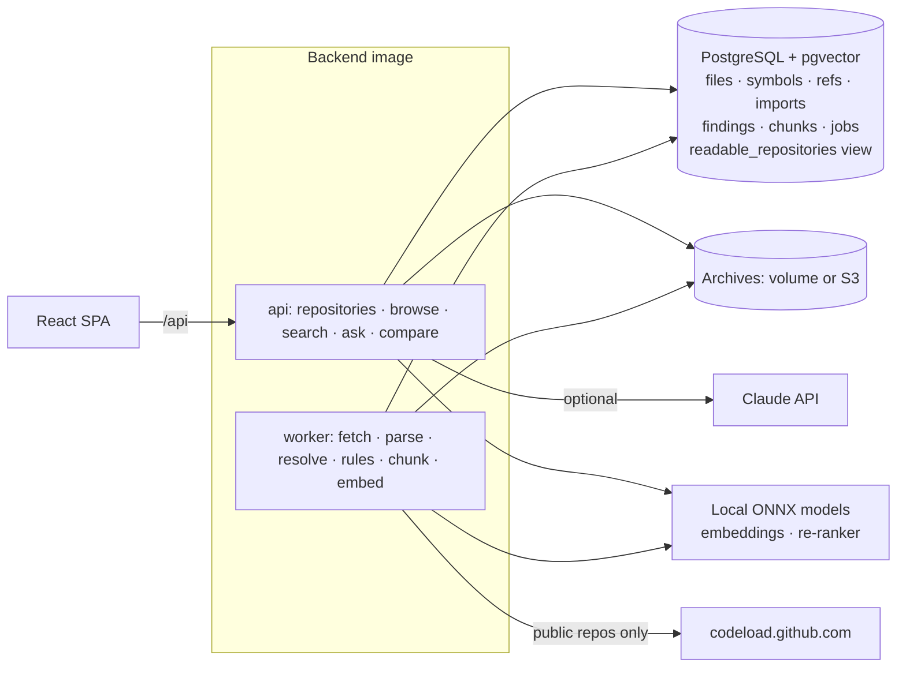

# Design — AI Developer Intelligence

**Status:** implemented. Section 10 records what changed during implementation and why.

## 1. Problem and goals

Developers spend a large share of their time *reading* code: finding where something happens, working
out what calls what, judging whether a change is safe. In a large or unfamiliar codebase this is slow,
and the knowledge needed (architecture, risky areas, who depends on a function) is rarely written down.

The platform imports a repository and answers, with evidence:

| Need | Feature |
|---|---|
| "Where is X done?" | Code search by meaning or by name; cited answers to questions about the code |
| "What is this, who uses it?" | Symbol pages: code, documentation, callers, callees, metrics, plain-language explanation |
| "How is this system organised?" | Overview: languages, central files, entry points, dependency graph, external packages |
| "Where are the problems?" | Deterministic security and quality findings with fixes; duplicates; dead code; import cycles |
| "Is this change safe?" | Snapshot comparison: changed functions, everything that calls them, tests to run, new/fixed findings, risk score |

**Non-goals:** running or building the code, type-checking, replacing a full SAST product, private
GitHub repositories (see known limitations).

## 2. Architecture

One backend image runs as **api** (FastAPI) and **worker** (PostgreSQL job queue with
`SELECT … FOR UPDATE SKIP LOCKED`, retries with backoff). Imports are asynchronous: the API stores the
archive and queues a job; the UI polls the snapshot's stage.

## 3. Data model

| Table | Purpose |
|---|---|
| `workspaces`, `workspace_members` | Teams and roles (owner / editor / reader) |
| `repositories` | A codebase in a workspace; optional GitHub URL and default ref; pointer to the latest ready snapshot |
| `snapshots` | One imported version (ZIP upload or GitHub ref): status, stage, statistics, skipped-file counts |
| `files` | Path, language, content, lines, health score, import-graph centrality and fan-in/out |
| `symbols` | Functions, methods, classes: lines, signature, docstring, decorators, complexity, nesting, body hash, fan-in/out, `tested` |
| `refs` | Every call site, with the resolved callee (or NULL) and *how* it was resolved |
| `imports` | Every import, classified internal / stdlib / external, with target files |
| `findings` | Rule, category, severity, line, message, redacted evidence, line-independent fingerprint |
| `duplicates` | Near-duplicate function pairs with similarity |
| `chunks` | Search units: code text, full-text vector of the *expanded* text, embedding, content hash |
| `questions`, `search_history` | Q&A history with citations; search analytics |
| `jobs`, `audit_log`, `users`, `refresh_tokens` | Platform |

`readable_repositories` is a view (repository × member × access). **Every** cross-repository query —
search, Q&A retrieval — joins through it, so access control lives in one place and inside SQL.

## 4. Analysis pipeline (`app/code/`)

1. **Archive** (`archive.py`) — limits on entries, total size and file size; rejects absolute paths and
   `..` before anything else; strips GitHub's top-level folder; skips VCS, dependency and build folders,
   binaries and minified bundles. Nothing is written to disk under archive-controlled names.
2. **Parse** (`parser.py`, `languages.py`) — tree-sitter for Python, JavaScript, TypeScript/TSX, Go and
   Java. One iterative walk per file collects symbols, calls, imports and markers. Everything
   language-specific is data (`LanguageSpec`): which node types define functions/classes, which are
   calls, which add a decision point, which nest.
3. **Resolve** (`resolve.py`) — imports to files (Python module paths incl. relative imports and
   `src/` layouts; JS/TS relative paths, extensions and `index` files; Go module paths from `go.mod`;
   Java package paths), then calls to symbols. Each edge records its method: `local`, `self`,
   `import`, `package` (Go), or the `unique-method` heuristic (`obj.name()` where exactly one in-repo
   method has that distinctive name). Generic names (`get`, `save`, `execute`…) are never guessed.
4. **Graph** (`graph.py`) — file import graph: Tarjan strongly-connected components (iterative) for
   cycles; PageRank for "central" files; fan-in/out.
5. **Rules** (`rules.py`) — deterministic findings (table below), each with a fix suggestion.
6. **Duplicates** (`duplicates.py`) — function bodies → normalised tokens (identifiers `$`, literals `#`),
   shingles of six consecutive tokens, MinHash with 128 permutations, LSH banding (32×4), Jaccard ≥ 0.8.
7. **Chunk** (`chunking.py`) — one chunk per function/method (long ones in 60-line windows that repeat
   the signature), one summary chunk per class, module-level code in windows, text files in windows.
   Full-text indexing uses *expanded* text: `calculateOrderTotal` also indexes as "calculate order total".
8. **Store and embed** (`pipeline/runner.py`) — bulk inserts; embeddings with `bge-small-en-v1.5`
   (local ONNX). Chunks whose embedded text is unchanged since the previous snapshot reuse its embedding.

### Rules

| Rule | Category | Trigger |
|---|---|---|
| hardcoded-secret | security | AWS key IDs, private keys, GitHub/Slack/Stripe tokens, or a `password/secret/api_key…` assignment with a high-entropy, non-placeholder value. Evidence is redacted |
| sql-injection | security | A query sink (`execute`, `query`, `Query`, `executeQuery`, SQLAlchemy `text`…) whose first argument is an f-string, template literal, `%`/`+` concatenation involving a variable, or `format`/`Sprintf` |
| dangerous-eval | security | `eval`/`exec`, `new Function` |
| insecure-deserialization | security | `pickle/marshal.load(s)`, `yaml.load` without `SafeLoader` |
| shell-injection | security | `subprocess.*(shell=True)`, `os.system/popen`, `child_process.exec`, `exec.Command("sh","-c",…)` |
| tls-verification-disabled | security | `verify=False`, `rejectUnauthorized: false`, `InsecureSkipVerify: true` |
| weak-hash | security | `hashlib.md5/sha1` (unless `usedforsecurity=False`) |
| dangerous-html | security | `dangerouslySetInnerHTML`, `innerHTML`/`outerHTML` assignment |
| swallowed-exception | reliability | `except …: pass`, empty `catch {}` |
| high-complexity | maintainability | cyclomatic complexity ≥ 11 (≥ 21 high) |
| long-function | maintainability | > 60 lines (> 120 medium) |
| deep-nesting | maintainability | control flow nested > 4 deep |
| too-many-parameters | maintainability | > 6 parameters |
| duplicate-code | maintainability | MinHash similarity ≥ 0.8 with another function |
| dead-code | maintainability | No resolved caller **and** the name appears nowhere else in the repository; decorated, exported (JS/Go/Java), entry-point, dunder, test and public-method symbols are never reported |
| import-cycle | design | Files in a strongly connected component of the import graph |
| todo | maintainability (info) | TODO / FIXME / HACK / XXX comments |

Findings in test files are one severity level lower for secrets. **File health** = 100 − penalties
(high 15, medium 6, low 2) per 100 lines; grades A ≥ 90, B ≥ 75, C ≥ 60, D ≥ 40, E below.

## 5. Search and questions

**Search** (`retrieval/search.py`): the latest ready snapshot of each readable repository (or one
requested snapshot) → keyword branch (PostgreSQL full text over the expanded text, OR of query terms
with identifier parts) and vector branch (exact cosine scan over the allowed chunks) → Reciprocal Rank
Fusion → optional cross-encoder re-ranking (`ms-marco-MiniLM-L-6-v2`). Filters: repository, language,
path prefix, tests.

**Questions** (`retrieval/qa.py`): hybrid retrieval with re-ranking → **relevance gate** (best
re-ranker score ≥ `ADI_MIN_RERANK_RELEVANCE`, otherwise "not found" without calling any model) →
implementation code ordered before tests → answer:

* **Claude** (when `ANTHROPIC_API_KEY` is set): each chunk is a `document` block titled with its file,
  lines and symbol, with native citations enabled. Code is untrusted data; the model has no tools.
* **Offline**: lists the most relevant functions with their own documentation, each cited. It never
  writes prose, and the UI labels it as offline.

"No citation, no answer": an answer without citations is withheld. Failures of the Claude call fall
back to the offline answer, with a note.

**Explain** (`GET /symbols/{id}/explain`): Claude, when configured, explains the code using the call-graph
facts as context; offline, the facts themselves (callers, callees, metrics, tests, decorators) are shown.

## 6. Change impact (`modules/code/impact.py`)

Between two snapshots of a repository:

1. **Changed** functions: same `(path, qualified name)`, different hash of the whitespace-normalised
   body. **Added** / **removed** by key.
2. **Blast radius**: breadth-first search *backwards* through the head snapshot's call graph from every
   changed or added function, up to 3 calls. Reached test functions = **tests to run**.
3. **Untested changes**: changed functions that no test reaches.
4. **New / fixed findings** by fingerprint (rule + path + symbol + key, no line numbers).
5. **Risk score** — a points system, each part returned with its reason:
   3 per changed + 2 per added function (max 25); complexity above 10 of changed code (max 20);
   2 per affected caller (max 20); 15 per new high + 5 per new medium finding (max 25);
   3 per untested change (max 10). Low < 25 ≤ medium < 50 ≤ high.

## 7. API

`/api/v1` — auth (`/auth/login`, `/auth/refresh`, `/auth/logout`, `/auth/me`), users, workspaces and
members, `/repositories` (+ `/snapshots:upload`, `/snapshots:github`, `/snapshots`, `/compare`),
`/snapshots/{id}` (+ `/overview`, `/files`, `/file?path=`, `/symbols?q=`, `/findings`,
`/dependencies`, `/duplicates`, `/reprocess`), `/symbols/{id}` (+ `/explain`), `/search`, `/ask`,
`/questions`, `/system/info`, `/admin/*`. OpenAPI at `/api/docs`. Errors are RFC 9457 problem details.

## 8. Security

| Threat | Control |
|---|---|
| Reading another team's code | Workspace membership checked on every endpoint (404, not 403, for non-members); search and Q&A scoped in SQL through `readable_repositories`; leakage measured by the evaluation |
| SSRF through GitHub import | URL parsed into owner/repo; only `codeload.github.com`/`github.com`; HTTPS/443; DNS resolved once, every address must be public; connection pinned to the checked IP; redirects re-validated; size and time limits |
| Zip bombs / path traversal | Entry, size and per-file limits; absolute and `..` paths rejected; nothing written to disk under archive names |
| Prompt injection in code | Code and comments are data, stated in the system prompt; the model has no tools; answers must cite retrieved chunks |
| Secrets in analysed code | Evidence redacted to the first 4 characters; the demo's planted secrets are generated at build time and never committed |
| Account takeover | argon2id, lockout, login rate limit, 15-min JWT access tokens in memory, rotating httpOnly refresh cookies with reuse detection |
| Abuse | Q&A rate limit per user; upload size limit; job retries bounded |

## 9. Evaluation method

`python -m app.cli evaluate` on the demo repository *fernwood-shop* (fictional; Python API, TypeScript
web client, Go service; 61 files) with answers labelled by hand in `backend/demo/ground_truth.json`
**before** running the analyser: 21 planted findings, 27 callers with all 78 of their in-repo calls,
1 import cycle, the full v1 → v2 change impact, and 47 questions (40 answerable, including paraphrases
and bare identifiers, and 7 unanswerable). Questions are asked as *dana*, who is not a member of the
workspace holding a second repository (this platform's own source, which also has a `hash_password`)
— any citation from it counts as leakage.

## 10. Changes during implementation

| Change | Why |
|---|---|
| SQL-injection rule ignores concatenation of literals and `UPPER_CASE` constants | The first run flagged `"SELECT " + COLUMNS + " FROM …"` (2 false positives). Joining constants is safe; joining variables or call results is not |
| Archive paths are validated before stripping the top-level folder | A test found that an archive containing only `../evil.py` was treated as having a common root folder and silently stripped. Harmless (nothing is written to disk) but now rejected outright |
| `build_archive` writes a fixed timestamp | Identical files must give identical bytes so duplicate uploads are detected |
| Embeddings reused across snapshots (content hash) | Embedding is the slow step on CPU (~4 chunks/s on a laptop). Re-importing the demo after a small change went from ~60 s to ~5 s (178 of 186 chunks reused) |
| Q&A relevance gate 0.2 → **0.01** | The re-ranker was trained on web search text and scores code low. At 0.2, 22.5 % of answerable questions were refused. On the benchmark every unanswerable question scored ≤ 0.005, while answerable paraphrases scored 0.002–0.19. The threshold was **chosen on the same benchmark**, so its numbers are optimistic |
| Search re-ranking off by default | It improved MRR by only 0.02 (0.765 → 0.789) and cost ~3.5 s per query. Q&A still re-ranks (the gate depends on it) |
| Q&A orders implementation code before tests | Tests that mirror a function's name sometimes outranked the function itself |
| Hybrid search kept as default although vector-only scored slightly higher here (MRR 0.788 vs 0.765) | The keyword branch is what finds exact strings — error messages, constants, configuration keys — which a 40-question benchmark under-represents |
